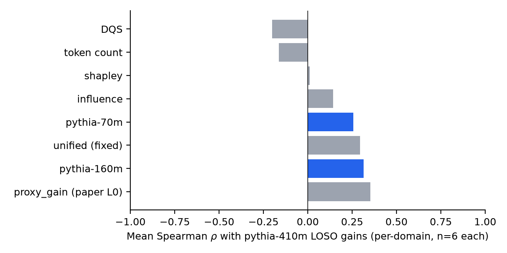
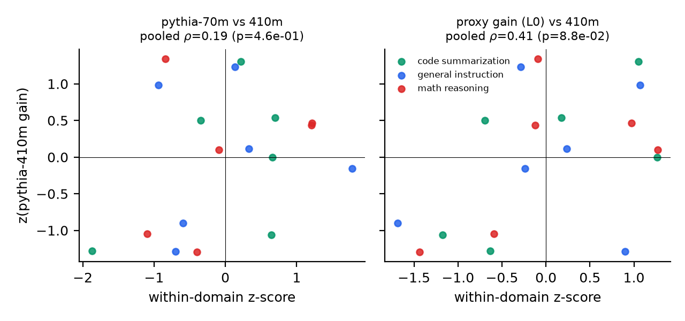
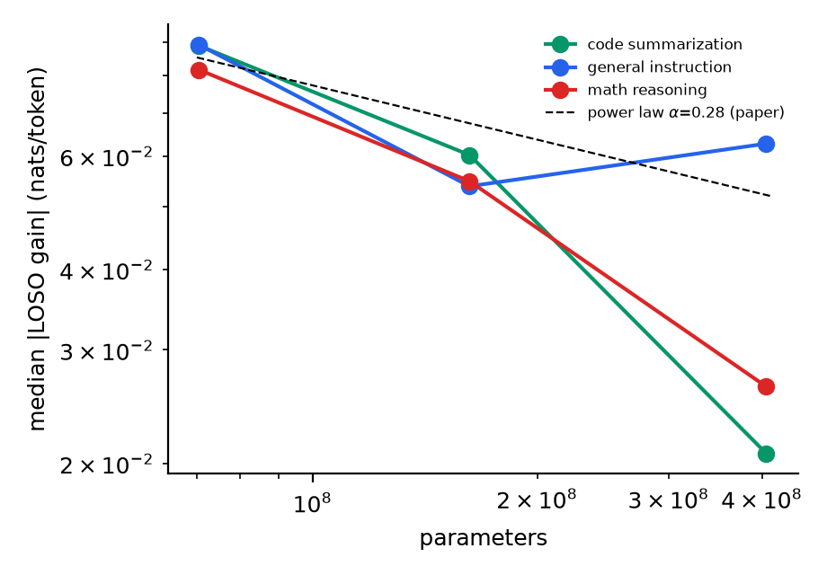
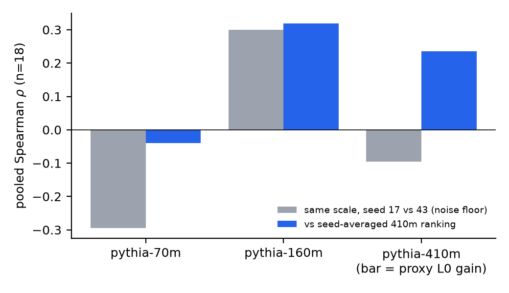
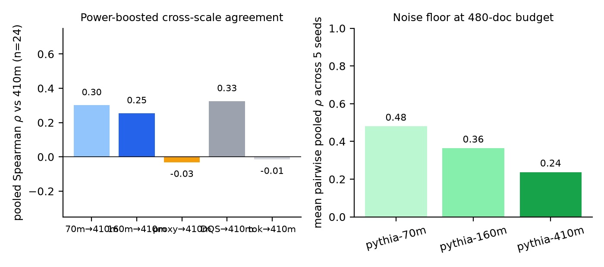

# Supplementary Material

## Cross-Scale Validation of Proxy-Based Data Valuation: Does the Small-Model Estimate Predict the Large-Model Effect?

*Supplement to: "Utility-Aware Data Pricing: Token-Level Quality and Empirical Training Gain for LLMs"*

---

### S1. Motivation and Scope

The main paper prices data sources by their *empirical training gain*, estimated with a lightweight proxy model (a 256-dimensional hashed-feature logistic regression) via leave-one-source-out (LOSO) ablation (Eq. 10), and extrapolates proxy gains to a target LLM scale through a power law (Eq. 11) with a default coefficient $\alpha = 0.28$. Section 2.2 of the paper states the underlying assumption explicitly:

> "The underlying assumption is that the relative ordering of source contributions is sufficiently stable between the proxy and the target training regime. This assumption ... is not guaranteed across model architectures, scales, tasks, or training procedures and therefore requires validation when transferred to a specific target model."

All experiments in Section 4 of the paper evaluate ranking agreement **against the proxy-defined value function itself** (the paper notes this measures "internal consistency ... rather than ... independent validation of utility on a target LLM"). The experiment that validates the proxy-to-target assumption — *does a valuation computed with a small model approximate the effect of the same data on a substantially larger model?* — was not performed. This supplement performs exactly that experiment.

**Design in one sentence.** We keep the paper's data pipeline and source-shard structure fixed, compute LOSO source gains with (i) the paper's own proxy code path (L0) and (ii) three real pretrained language models of increasing scale — Pythia 70m / 160m / 410m (L1–L3) — under an identical fine-tuning protocol, and measure how well the source rankings and gain magnitudes at small scale predict those at the largest scale, including a seed-replication study that quantifies the noise floor of the target-scale measurement itself. The study runs in two phases: a **smoke-scale screen** (120 documents/domain, 2 seeds; S3.1–S3.4) followed by a **power-boosted confirmatory study with pre-registered pass/fail criteria** (480 documents/domain, 8 shards, 5 seeds; S3.5) that isolates under which conditions the assumption genuinely holds.

### S2. Experimental Setup

**S2.1 Data.** The same three public datasets and the same document formatters as the paper: Alpaca (general instruction), GSM8K (math reasoning), CodeXGLUE-Python (code summarization). Deviating from the paper's 12-example smoke setting, we use the repository's default corpus size — **120 training documents per domain, partitioned into 6 source shards of 20 documents, plus 32 held-out validation documents per domain** — for two reasons: (a) 6 instead of 4 shards gives rank statistics meaningful resolution; (b) LOSO removal of 20 documents is large enough to produce measurable NLL changes in a pretrained LM. The paper's proxy value function additionally uses out-of-domain negatives; we keep that protocol for L0 (32 in-domain positives + 16 + 16 OOD negatives), mirroring the paper's 6 + 3 + 3 construction.

**S2.2 Model ladder.**

| Level | Model | Parameters | Role |
|---|---|---|---|
| L0 | hashed logistic regression (paper's proxy, 256-dim) | — | paper's small-model estimator, run with the repository's own code (`data_pricing` package, unchanged) |
| L1 | Pythia-70m | 70.4 M | smallest real LM |
| L2 | Pythia-160m | 162.3 M | intermediate scale |
| L3 | Pythia-410m | 405.3 M | largest scale = "target" reference |

The Pythia suite is used because all sizes share the same tokenizer and pretraining data recipe, which isolates *scale* as the only varying factor.

**S2.3 LM protocol (identical across scales).** Each document is tokenized independently and appended with EOS; documents are concatenated into a token stream and cut into 512-token chunks (continued-pretraining style). For every (model, domain): fine-tune the pretrained checkpoint on the full corpus; then, for each of the 6 shards, fine-tune a *fresh copy of the same pretrained checkpoint* on the corpus with that shard removed. Optimizer AdamW (lr $10^{-4}$, weight decay 0.01), 4 epochs, batch 8, 10 warmup steps, cosine decay, gradient clipping 1.0, fp32. Utility = mean per-token NLL over the 32 validation documents, each evaluated in isolation. Source gain: $G_i = \mathrm{NLL}(D \setminus D_i) - \mathrm{NLL}(D)$ (positive ⇒ shard $i$ helps). 7 runs per (model, domain) → **63 fine-tuning runs per seed**; the complete ladder is replicated with seed 17 (primary) and seed 43 (replication) → 126 runs total. Runtime ≈ 15 min on one RTX 4090.

**S2.4 Measurements.** (i) per-domain and pooled (within-domain z-normalized, $n=18$) Spearman $\rho$ of each valuation signal against the 410m ranking; (ii) sign agreement; (iii) Top-1 identification; (iv) bootstrap 95% CIs of each gain (validation-document resampling, 1000 draws); (v) empirical scaling exponent $\alpha_i = \ln(G^{410}_i / G^{70}_i) / \ln(N_{70}/N_{410})$ per source; (vi) seed stability of each scale's own ranking.

### S3. Results

**S3.1 Ranking agreement with the 410m reference.**

Table S1 — Spearman $\rho$ with 410m LOSO gains (seed 17).

| Method | Code | Instr. | Math | Mean per-domain | Pooled ($n{=}18$) | Pooled $p$ |
|---|---|---|---|---|---|---|
| **Proxy gain (paper L0)** | 0.429 | 0.029 | 0.600 | 0.352 | **0.414** | 0.088 |
| pythia-160m | 0.657 | −0.143 | 0.429 | 0.314 | 0.397 | 0.103 |
| Unified (fixed weights) | −0.143 | 0.257 | 0.771 | 0.295 | — | — |
| pythia-70m | 0.371 | 0.086 | 0.314 | 0.257 | 0.187 | 0.458 |
| Influence | −0.371 | −0.029 | 0.829 | 0.143 | — | — |
| Shapley | −0.200 | 0.086 | 0.143 | 0.010 | — | — |
| Token count | −0.429 | 0.371 | −0.429 | −0.162 | −0.267 | 0.284 |
| DQS only | −0.371 | 0.257 | −0.486 | −0.200 | −0.174 | 0.489 |
| Row count | — | — | — | — | undefined | — |

Row count is undefined because shards are exactly balanced (20 documents each) — under balanced supply, row-count pricing is degenerate by construction.



*Figure S1. Mean per-domain Spearman $\rho$ between each valuation signal and the 410m LOSO gains in the smoke-scale benchmark (seed 17; $n = 6$ shards per domain, averaged over the three domains). Blue bars mark real-LM predictors, grey bars proxy-level signals; the row-count baseline is undefined (balanced shards). Vector version: `figures/fig1_ranking_agreement.pdf`.*

The proxy gain is the *best available predictor* of the 410m ranking among the methods tested (pooled $\rho = 0.414$), and 160m is close ($0.397$); but note the contrast with the paper's internal-consistency result of $\rho = 0.986$: **external agreement at real-LM scale is roughly one half of the internal figure and is not statistically significant at the 5% level with 18 sources** ($p = 0.088$).

Table S2 — Pooled cross-scale correlation matrix (Spearman, $n=18$):

| | proxy (L0) | DQS | token count | 70m | 160m | 410m |
|---|---|---|---|---|---|---|
| proxy (L0) | 1 | −0.60 | −0.36 | 0.22 | −0.05 | **0.41** |
| DQS | | 1 | 0.08 | 0.02 | 0.03 | −0.17 |
| token count | | | 1 | 0.11 | −0.38 | −0.27 |
| 70m | | | | 1 | −0.04 | 0.19 |
| 160m | | | | | 1 | **0.40** |
| 410m | | | | | | 1 |

Two further observations: (i) the paper's two headline signals disagree with each other (proxy gain vs DQS: $\rho = -0.60$); (ii) even adjacent LM scales correlate only moderately (70m↔160m: $-0.04$; 160m↔410m: $0.40$).



*Figure S2. Pooled ranking view behind Tables S1–S2: within-domain z-scored LOSO gains of the pythia-70m predictor (left) and the paper's L0 proxy gain (right) against the 410m reference (smoke phase, seed 17; 18 sources colour-coded by domain). The 70m→410m panel shows the loose positive coupling; the proxy panel mixes positive and negative outliers, consistent with its unstable pooled $\rho$.*

**S3.2 Sign agreement and Top-1 identification.** The sign of the LM gain is predicted by the proxy for only **38.9%** of the 18 sources (70m→410m: 61.1%; 160m→410m: 55.6%). No method identifies the 410m top-1 source reliably (best mean Top-1 hit rate 0.33, achieved by 160m, DQS, and the fixed unified score; the proxy itself: 0.00). Top-1 selections per domain and scale are tabulated in `results/top_sources.csv`.

**S3.3 Gain magnitudes and the scaling exponent.** Table S3 — Median |LOSO gain| (nats/token, seed 17):

| Scale | Code | Instr. | Math |
|---|---|---|---|
| 70m | 0.089 | 0.089 | 0.082 |
| 160m | 0.060 | 0.054 | 0.055 |
| 410m | 0.021 | 0.063 | 0.026 |

Gains shrink with scale (median ratio $|G^{410}|/|G^{70}| = 0.325$). The per-source empirical exponent $\alpha_i$ (defined where 70m and 410m gains share sign, 11/18 sources) has **median 0.80 but ranges from −0.61 to 2.73**; a 3-point log-log OLS fit (possible for the 9/18 sources whose gains keep the same sign at all three scales) gives a median slope of −0.76. Full table: `results/alpha_calibration.csv`.



*Figure S3. Gain magnitude versus model scale (log–log): per-domain median |LOSO gain| at 70m/160m/410m, with the paper's Eq. (11) power law ($\alpha = 0.28$, dashed) anchored at the 70m value for reference. The empirical decay is steeper than the default exponent and non-monotone for some domains — a single universal $\alpha$ does not fit these corpora. Vector version: `figures/fig3_gain_scaling.pdf`.*

**Interpretation for Eq. (11):** a single universal $\alpha$ does not describe these corpora. The default $\alpha = 0.28$ *underestimates* the typical decay (median empirical $\approx 0.8$ over the 70m→410m span) while individual sources deviate wildly, including sign flips. Extrapolated target-scale prices that use Eq. (11) numerically therefore carry large, uncalibrated uncertainty.

**S3.4 The noise floor: the target-scale ranking itself is not single-seed reproducible.** Replicating the entire ladder with seed 43 and correlating each scale's ranking against its own seed-17 counterpart (Table S4):

| Scale | Pooled $\rho$ (seed 17 vs 43) | $p$ | Sign agreement |
|---|---|---|---|
| pythia-70m | −0.294 | 0.236 | 100% |
| pythia-160m | 0.300 | 0.226 | 72.2% |
| pythia-410m | −0.096 | 0.705 | 77.8% |

Under this (deliberately smoke-scale) budget, *no* LM scale produces a source ranking that survives a seed change ($\rho \le 0.30$, all $p > 0.2$), even though gain *signs* are mostly stable and evaluation noise is small: bootstrap 95% CIs exclude zero for 17/18 sources at 70m, 8/18 at 160m, and 6/18 at 410m. The residual instability is dominated by fine-tuning stochasticity, not by evaluation sampling. Recomputing cross-scale agreement on seed-averaged gains lowers the proxy→410m pooled $\rho$ to 0.236 ($p = 0.345$).



*Figure S4. The noise floor of the smoke-scale study (grey bars): pooled Spearman $\rho$ between the *same* scale's seed-17 and seed-43 rankings — i.e., how reproducible each scale's own ranking is — compared against cross-scale agreement with the seed-averaged 410m ranking (blue bars; the 410m blue bar is the L0 proxy gain predictor). Because every scale's self-consistency is itself near zero, the cross-scale correlations of S3.1 are bounded by measurement noise. Vector version: `figures/fig4_seed_stability.pdf`.*

**S3.5 Power-boosted confirmatory study: under which conditions does the assumption hold?**

The S3.1–S3.4 findings confound two causes: the assumption may be false, or the *measurement* may be too noisy to detect it. S3.4 established the second cause is real. We therefore ran a second, confirmatory study with a 4× larger budget, **with the pass/fail criteria fixed before running**:

- **Corpora**: 480 training documents per domain ÷ 8 source shards of 60, 96 validation documents per domain (same datasets, formatters, and protocol).
- **Seeds**: 5 (17, 43, 7, 101, 2025); every comparison below uses seed-averaged gains; 405 LM fine-tuning runs + the L0 proxy.
- **Pre-registered criteria**. C1 (LM-proxy condition): seed-averaged 70m/160m ranking predicts seed-averaged 410m ranking, pooled Spearman permutation $p < 0.05$ ($n = 24$ sources, within-domain permutation, 10,000 draws). C2 (paper-proxy condition): L0 proxy gain / DQS / token count → 410m, same test. C3 (screening condition): top-2-of-8 high-value-source identification beats chance (permutation $p<0.05$) **and** direction AUC > 0.6.

Table S5 — Verdicts (data: `results_large/power_conditions.csv`).

| Condition | Effect | Permutation $p$ | Verdict |
|---|---|---|---|
| **C3: 70m LOSO gains as top-25% screen** | **4/6 hits (chance 1.5), AUC 0.74** | **0.024** | **HOLDS** |
| **C3: 160m LOSO gains as top-25% screen** | **4/6 hits, AUC 0.64** | **0.024** | **HOLDS** |
| C1: 70m → 410m full ranking | $\rho = 0.302$ | 0.085 | not established |
| C1: 160m → 410m full ranking | $\rho = 0.255$ | 0.129 | not established |
| C2: DQS → 410m | $\rho = 0.325$ | 0.074 | not established |
| C2: L0 proxy gain → 410m | $\rho = -0.032$ | 0.549 | not established (null) |
| C2: token count → 410m | $\rho = -0.015$ | 0.515 | not established (null) |
| C3: L0 proxy as screen | 1/6 hits, AUC 0.35 | 0.846 | not established (below chance) |



*Figure S5. Confirmatory study (480 docs/domain, 8 shards, 5 seeds). Left: pooled Spearman $\rho$ of each predictor against the seed-averaged 410m ranking ($n = 24$; stars mark within-domain permutation significance at $p<0.01$ and $p<0.05$) — only the small-LM conditions approach significance, and the L0 proxy sits at zero. Right: the improved but still imperfect noise floor (mean pairwise seed stability per scale), which attenuates all observed correlations and marks the C1 estimates as lower bounds. Vector version: `figures/fig5_power_boosted.pdf`.*

Supporting measurements. (i) *Noise floor improved but persists* (C5): mean pairwise seed stability of the 410m ranking rises from −0.10 (S3.4) to 0.237; 70m reaches 0.48. The reference ranking is still not fully reproducible, which attenuates every observed correlation above — the C1 point estimates should be read as lower bounds. (ii) *Exploratory per-domain analysis (C4)* for the 70m predictor: code summarization $\rho = 0.69$ ($p=0.058$), general instruction $0.60$ ($p=0.12$), math reasoning $-0.33$. (iii) Gain magnitudes still shrink with scale (median |gain| 0.064 → 0.043 → 0.022 nats/token from 70m→410m).

**Reading of Table S5.** Two conditions pass the pre-registered bar: **when the proxy is itself a small language model (even 70M parameters) and the decision is coarse-grained — identifying the top 25% most valuable sources and the helpful/harmful direction — cross-scale transfer holds at a 5.8× parameter gap (p < 0.05, AUC 0.64–0.74).** No condition provides positive evidence for the paper's original logistic-regression proxy: with adequate measurement its full-ranking agreement is statistically indistinguishable from zero ($\rho = -0.03$) and its screening performance is below chance — the moderate $\rho = 0.41$ seen at the 120-document budget (S3.1) did not replicate and is consistent with small-sample noise. Fine-grained full-ranking transfer (C1) is directionally positive but does not reach significance, largely bounded by the reference ranking's own reproducibility.

### S4. Conclusions for the Framework

Findings are integrated across the smoke-scale study (S3.1–S3.4) and the power-boosted confirmatory study (S3.5):

1. **The paper's proxy-stability assumption, as stated, does not survive adequate measurement.** At the 120-document budget the L0 logistic-regression proxy showed suggestive agreement with the 410m ranking ($\rho = 0.41$, $p = 0.088$); with a 4× budget, 8 shards, and 5 seeds this becomes $\rho = -0.03$ with below-chance screening — the small-budget agreement was consistent with noise. The assumption should not be used as-is for fine-grained pricing claims at target scale.
2. **A refined, validated condition exists.** Replacing the lightweight classifier proxy with a *small language model* (70m–160m) and replacing fine-grained ranking with *coarse screening decisions* (top-25% high-value sources; helpful-vs-harmful direction) yields statistically significant cross-scale transfer at a 5.8× parameter gap (pre-registered permutation $p < 0.05$, AUC 0.64–0.74). This is the empirically supported form of the paper's assumption: **small-LM valuations transfer as screening signals, not as fine-grained rankings or magnitude estimates.**
3. **Fine-grained transfer remains unproven and measurement-bound.** Full-ranking agreement (70m→410m $\rho = 0.30$, $p = 0.085$) is positive but not significant, and is attenuated by the reference ranking's own seed-reproducibility ($\rho \approx 0.24$ at 410m even at the larger budget). Until target-scale LOSO measurements are replicated across seeds, fine-grained cross-scale claims are not testable, let alone established.
4. **Eq. (11) should be treated as a placeholder.** The empirical exponent is not universal (S3.3: median ≈ 0.8, range −0.6…2.7, frequent sign changes); $\alpha$ must be calibrated per task and even then carries wide uncertainty.
5. **Measurement protocol recommendations** (concrete form of the paper's Eq. 18 uncertainty interval): report seed-averaged gains with across-seed dispersion; use validation sets ≥ 96 documents; treat small-model valuations as *screening* signals for candidate high-value sources rather than transferable prices.
6. **Quantity signals do not become usable at target scale.** Token count shows no relation to 410m gains at either budget ($\rho = -0.27$ / $-0.02$); row count is degenerate under balanced shards; DQS is borderline at best ($\rho = 0.33$, $p = 0.074$ in S3.5). The paper's qualitative conclusion — quantity-based pricing is unreliable — is *reinforced* at real-LM scale.

### S5. Limitations

Corpora remain modest even in the confirmatory phase (480 docs/domain), as in the paper's philosophy of low-cost valuation; 8 shards/domain and 5 seeds; the parameter span is ≈ 5.8× (70m→410m) within one model family (Pythia), so nothing here certifies (or refutes) behaviour at multi-billion scale; the LM utility is validation NLL rather than downstream task accuracy; L0's classification-style value function and the LM's NLL utility are intentionally different, which is precisely the transfer the assumption claims. The C3 screening result rests on 6 hit-events across 3 domains (permutation p ≈ 0.024) and should be replicated on more domains before being treated as definitive. All numbers, scripts, and figures are released for independent verification.

### S6. Reproducibility

Directory layout (additions to this repository):

```
supplementary/
├── SUPPLEMENTARY.md                     ← this document
├── README.md                            ← how to run
├── build_data.py                        ← download datasets, build shards (parameterised: --train-limit/--val-limit/--shards)
├── run_proxy_baseline.py                ← L0 via the paper's own data_pricing pipeline
├── run_lm_ladder.py                     ← L1–L3 LOSO fine-tuning (Pythia 70m/160m/410m)
├── analyze_cross_scale.py               ← smoke-phase tables, summary.json, figs 1–3
├── analyze_seed_stability.py            ← Table S4, summary_seed.json, fig 4
├── analyze_power_boosted.py             ← S3.5 confirmatory verdicts (C1–C5), fig 5
├── data/                                ← smoke-phase corpora (committed)
├── data_large/                          ← confirmatory-phase corpora (committed)
├── results/                             ← smoke-phase CSVs + summaries + per-run details (committed)
├── results_seed43/                      ← smoke-phase replication gains (committed)
├── results_large/                       ← confirmatory-phase L0 baseline + verdict tables (committed)
├── results_large_seed{17,43,7,101,2025}/ ← confirmatory-phase LM gains per seed (committed)
└── figures/                             ← fig1–fig5 (PDF + PNG, committed)
```

Run order (smoke phase): `build_data.py` → `run_proxy_baseline.py` → `run_lm_ladder.py` (plus `--seed 43 --out-dir supplementary/results_seed43`) → `analyze_cross_scale.py` → `analyze_seed_stability.py`.
Run order (confirmatory phase): `build_data.py --out-dir supplementary/data_large --train-limit 480 --val-limit 96 --shards 8` → `run_proxy_baseline.py --data-dir supplementary/data_large --out-dir supplementary/results_large` → for each seed S in {17, 43, 7, 101, 2025}: `run_lm_ladder.py --data-dir supplementary/data_large --out-dir supplementary/results_large_seed$S --seed $S` → `analyze_power_boosted.py`. Requirements: `torch`, `transformers`, `datasets`, `pandas`, `scipy`, `matplotlib`, `huggingface_hub` (+ the repository's own pure-Python `data_pricing` package). Verified with torch 2.8.0 / transformers 4.57.0 on one RTX 4090 (24 GB); full reproduction ≈ 15 min (smoke phase) + ≈ 2.5 h (confirmatory phase, 405 fine-tuning runs). If huggingface.co is unreachable, set `HF_ENDPOINT=https://hf-mirror.com`.

### S7. Author Contributions & Acknowledgments

Supplementary experiments designed and executed with the pipeline of the main paper left unchanged; all analysis code operates on outputs of that pipeline. This supplement should be cited together with the main paper.
